# ADANISS 2R — Planar robotic arm that draws a trefoil

> **FR —** Bras robotique plan à deux degrés de liberté, conçu, fabriqué et asservi de bout en bout : génération de trajectoire paramétrique, cinématique inverse, identification des moteurs, correcteurs PID sur ESP32 et visualisation temps réel sous MATLAB.
>
> **ES —** Brazo robótico plano de dos grados de libertad diseñado, fabricado y controlado de principio a fin: trayectoria paramétrica, cinemática inversa, identificación de los motores, PID en ESP32 y visualización en tiempo real en MATLAB.

<p align="center">
  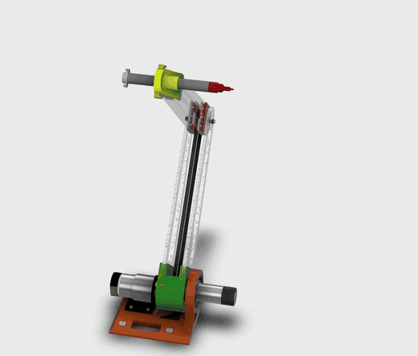
  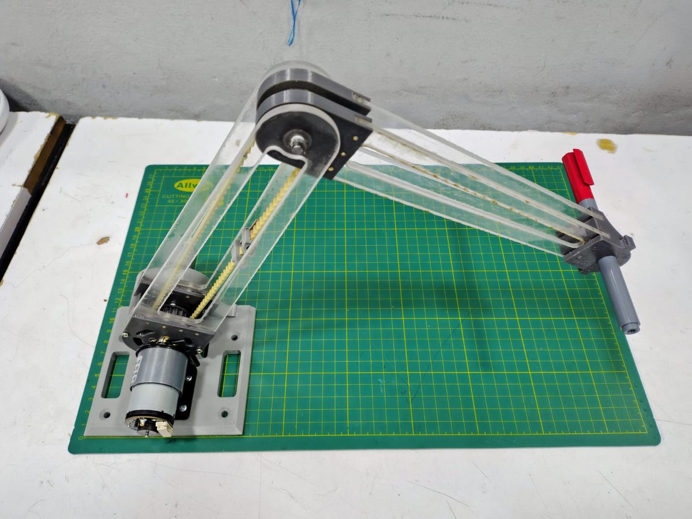
</p>

ADANISS is a two-link planar manipulator built for the *Servomecanismos* course at Universidad Nacional de Colombia (June 2026). A marker mounted on the end effector follows a closed **trefoil** path: first an approach trajectory from the calibration pose, then the cyclic trefoil, repeated indefinitely.

| | |
|---|---|
| **Kinematics** | 2 revolute joints, links L1 = L2 = 0.23 m, elbow-up configuration |
| **Actuators** | DC gear motors with quadrature encoders: shoulder 37 RPM / 0.8 N·m, elbow 100 RPM / 0.63 N·m (timing-belt transmission) |
| **Electronics** | ESP32 DevKit, 2 × BTS7960 (IBT-2) H-bridges, 2 × MAX471 current sensors, LM393 comparator, custom PCB |
| **Control** | Identified plant `K/(s(τs+1))` per joint, P design (Mp = 5 %), then PID tuned by root locus and discretised on the ESP32 |
| **Software** | MATLAB (trajectory, inverse kinematics, dynamics, live plot) and Arduino/ESP32 firmware |

---

## 1. Trajectory

The trefoil is a polar rose pushed away from the origin so the arm never approaches a singularity:

$$ r(\theta) = S\,\big(a + b\,\sin(k\theta + k\delta)\big), \qquad a > b $$

`k` sets the number of petals, `b/a` the petal depth, `δ` the orientation and `S` the scale in metres. Each point is shifted into the workspace (`X = r cos θ + g`, `Y = r sin θ + f`), checked against the reach `r ≤ L1 + L2`, and converted to joint references with the law of cosines.

<p align="center">
  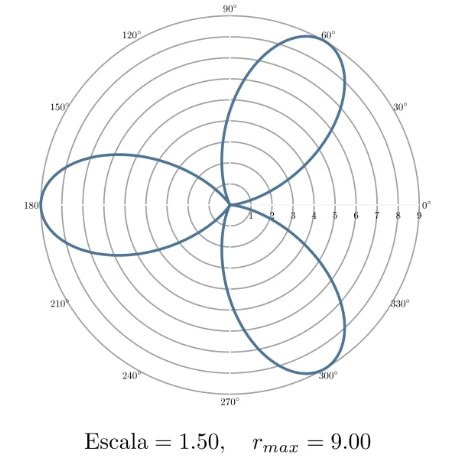
  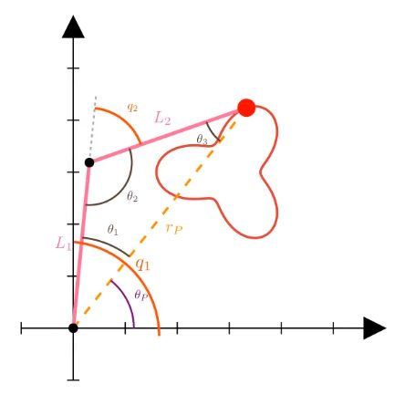
</p>

Joint trajectories are blended with a quintic time scaling `s(u) = 10u³ − 15u⁴ + 6u⁵` (zero velocity and acceleration at both ends), which removes the torque spikes where the approach path meets the cyclic path. Joint torques were estimated with the Lagrangian model `τ = M(q)q̈ + C(q,q̇)q̇ + G(q)` to size the motors (RMS and peak torque).

## 2. Identification of the motors

Each joint (motor + driver + encoder) was identified with constant-PWM pulse tests and fitted to `P(s) = K_amp / (s(τs + 1))`. Every fit reached **R² > 0.99**.

| Joint | K_amp [°/s/PWM] | τ [s] | Dead zone [PWM] |
|---|---|---|---|
| Shoulder | 0.69 | 0.135 | 16 / 8 |
| Elbow | 4.75 | 0.029 | 15 / 36 |

<p align="center">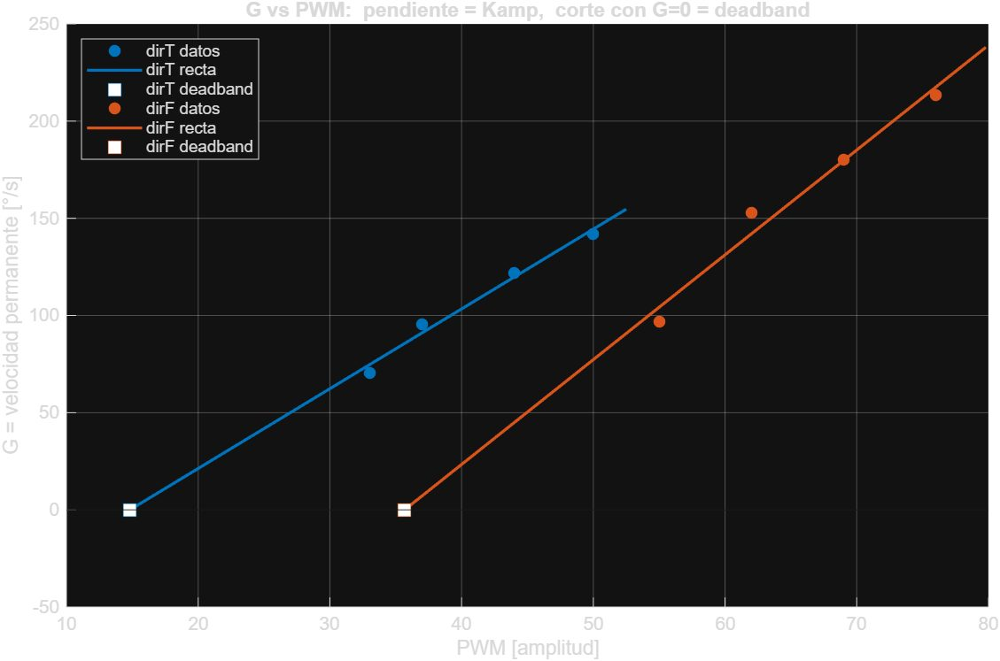</p>

The full procedure, raw data (CSV, three runs per amplitude and direction) and fitting scripts are in [`Caracterizacion/`](Caracterizacion).

## 3. Control

1. **Proportional design** for 5 % overshoot (ζ = 0.69) gives the base gains and shows the limit of pure P control: the real part of the closed-loop poles is fixed at −1/(2τ), so the settling time cannot be improved by raising the gain.
2. **PID tuning by root locus**, isolating Ki and then Kd in the characteristic equation. Phase margin ≈ 61° (shoulder) and ≈ 109° (elbow).
3. **Discrete implementation** on the ESP32: forward-Euler integral, backward-difference derivative with a first-order filter (N = 100).
4. **Hardware fine-tuning** to overcome dead zone, Coulomb friction and encoder noise:

| Joint | Kp | Ki | Kd | |
|---|---|---|---|---|
| Shoulder | 3.81 → **12.0** | 2.0 → **10.0** | 0.05 → **0.20** | theory → ESP32 |
| Elbow | 5.64 → **12.0** | 20.0 → **40.0** | 0.50 → **0.80** | theory → ESP32 |

## 4. Results

<p align="center">
  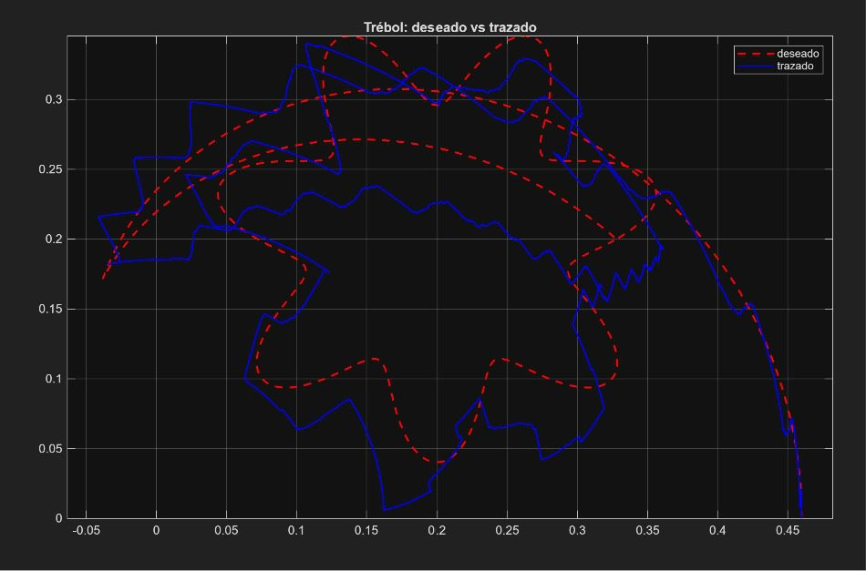
  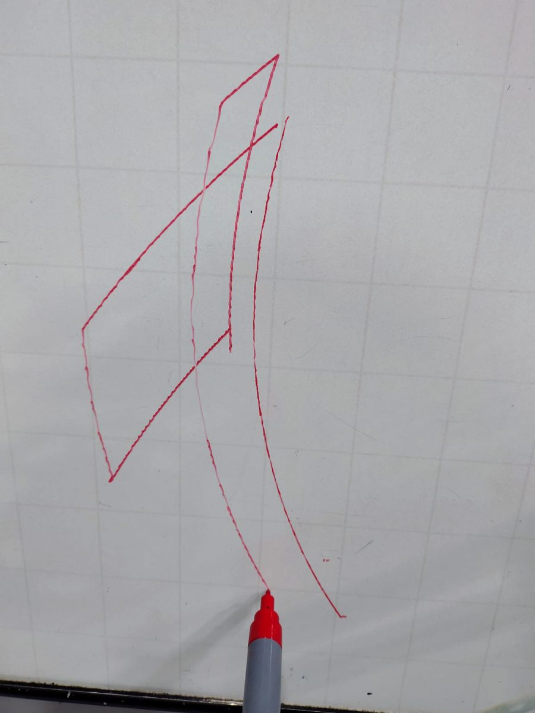
</p>

The arm draws the trefoil in cyclic mode. MATLAB receives the references and both encoder readings over serial at about 60 Hz, runs the forward kinematics and animates the arm next to the reference path in real time. The trajectory is sent once during setup and looped on the ESP32 to save memory.

## 5. Mechanics and electronics

<p align="center">
  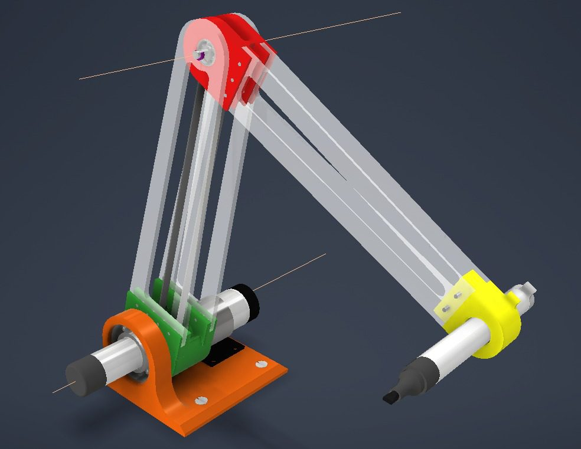
  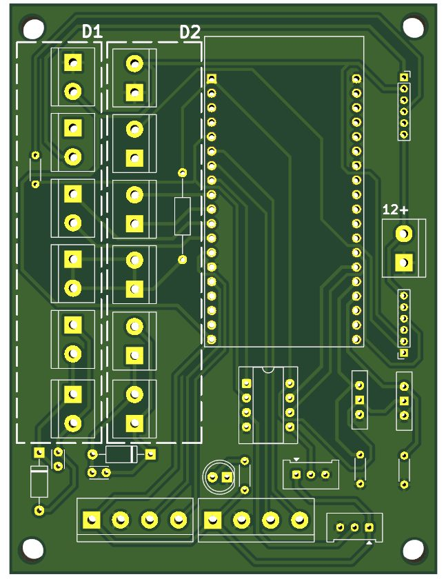
  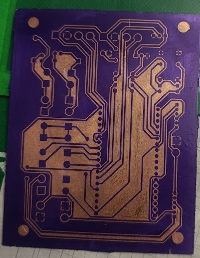
</p>

- Acrylic links and PETG joints (PLA prototype first), metal hubs on the motor shafts to remove backlash.
- Both motors sit at the shoulder; the elbow motor rides on L1 and drives the forearm through an enclosed timing belt.
- The schematic is split into power, control, drive and acquisition blocks. The PCB keeps power traces short and away from signals, and was made in-house with dry-film photoresist.

<p align="center">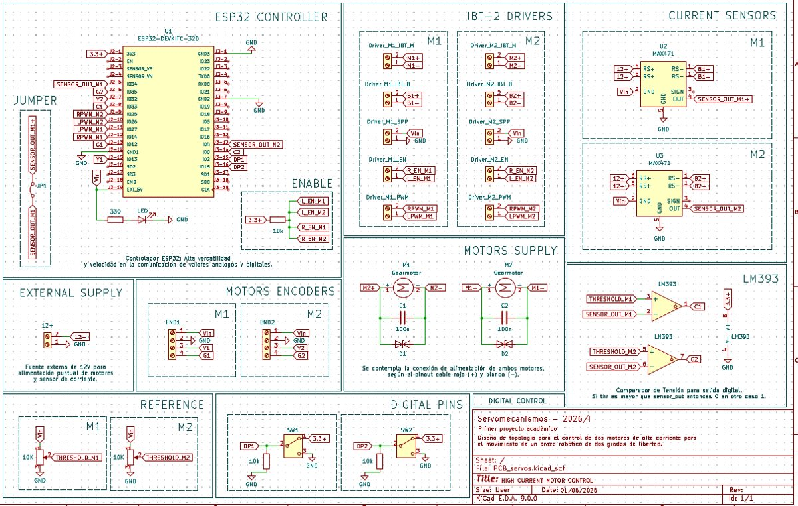</p>

## Repository layout

```
Codigos_Arduino/       ESP32 firmware: trajectory player, step tests, encoder testers, final TrebolEsp
Codigos_Matlab/        Trajectory, inverse kinematics, dynamics (MCG), serial upload, live plot
  Codigo_final/        Version used for the final demo (TrebolLive.m, subir_trebol.m, control.m)
Caracterizacion/       Shoulder and elbow identification: firmware, raw CSV data, fitting scripts, PDF reports
Documentacion/         Final report and intermediate documents
docs/img/              Figures used in this README
Videos_Youtube/        YouTube studio (Remotion + Manim): copy to D:\Videos_Youtube, see its README
```

## How to run

1. Flash `Codigos_Arduino/TrebolEsp/TrebolEsp.ino` on the ESP32 (Arduino IDE with the ESP32 core).
2. In MATLAB, set the trefoil parameters in `Codigos_Matlab/Codigo_final/ParametrosTrebol.m` (petals, scale, rotation, duration).
3. Run `subir_trebol.m` to send the approach and cyclic references over serial, then `TrebolLive.m` for the live view.

## Videos

- 🇪🇸 [La ecuación del trébol estilizado: coordenadas polares animadas con Manim](https://youtu.be/d2SLx9PkMOE)
- 🇫🇷 [L'équation du trèfle stylisé : coordonnées polaires animées avec Manim](https://youtu.be/9fZCj4uL7oE)

## Team

Samuel David Negrete Lancheros · Nicolás Plata Molano · Samuel Correales · Daniel Alejandro Torres Sanabria · Alessandra Quintero Rois

The design, build and tuning were done together by the whole team.

*Servomecanismos, Departamento de Ingeniería Mecánica y Mecatrónica, Universidad Nacional de Colombia, 2026.*
